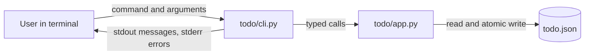

# Architecture

Design for the approved requirements in `artifacts/requirements.md` (FR-1 to FR-11, NFR-1 to NFR-4). It covers a small Python command-line task list and nothing else.

## Context

The user manages a list of tasks from a terminal: add, view, complete, reopen, delete (US-1). One person uses it at a time, on one machine, with no network access.



Existing code in `todo/` was written before the requirements were approved. It is a starting point, not a conforming implementation. Differences the later phases must close:

- No `reopen` command and no no-op messages (FR-7, FR-9).
- New ids are `max(id) + 1`, so an id is reused after the newest task is deleted (NFR-4, AC-2).
- Titles are whitespace-normalized and capped at 200 characters, so they are not stored exactly as entered (NFR-2, AC-13).
- Status is a boolean, not the `open` / `done` values the requirements name (FR-2, FR-3).
- Ids are parsed by `argparse` with `type=int`, so an invalid id exits with a usage error instead of the same clear error as an unknown id (FR-11).
- Commands are named `done` and `remove`; this design names them `complete` and `delete` to match the requirement wording.

Open questions from the requirements, answered here as design decisions so the next phases have something concrete. A human can overrule any of them at approval.

| Open question | Decision | Why |
|---|---|---|
| Persist between runs? | Yes, in a JSON file | A list that vanishes after each command is not usable from a command line. |
| Empty title? | Rejected with an error | A task with no visible title cannot be told apart in the list. A title of only whitespace counts as empty. |
| Invalid vs unknown id | Two different messages, same exit code | Tells the user whether to fix the typing or check the list. |
| Command names and wording | Defined under Data and Interfaces | The requirements leave them open. |

## Components

Two source files plus one data file. No other modules, no third-party packages.

| Component | File | Responsibility |
|---|---|---|
| Task logic | `todo/app.py` | `Task` and `Outcome` types, error types, id parsing, title validation, the `TodoList` class (add, list, complete, reopen, delete), loading and atomic saving of the JSON file. Contains no printing and no argument parsing. |
| Command line | `todo/cli.py` | Builds the argument parser, calls `TodoList`, turns results and errors into user messages, maps outcomes to exit codes. Contains no business rules. |
| Storage file | `todo.json` (path chosen by `--file`) | Single source of truth for tasks and the next id. Owned only by `TodoList`. |
| Tests | `tests/test_todo.py` | Exercises `app.py` directly and `cli.main()` with a temporary storage file. Written in the implementation phase. |

The dependency direction is one way: `cli.py` imports `app.py`; `app.py` imports only the standard library.

## Data and Interfaces

### Storage format

One UTF-8 JSON object, written with `ensure_ascii=False` so non-ASCII titles stay readable.

```json
{
  "version": 1,
  "next_id": 4,
  "tasks": [
    {"id": 1, "title": "Buy milk", "status": "open"},
    {"id": 3, "title": "Call Zoë", "status": "done"}
  ]
}
```

- `tasks` is in creation order. The order of the array is the creation order; tasks are only appended, never re-sorted.
- `next_id` is a counter that only grows. A new task takes `next_id` and then `next_id` increases by one. Deleting a task never lowers it, so an id is never reused (NFR-4, AC-2).
- `status` is exactly `open` or `done`.
- A missing file means an empty list with `next_id` of 1. The file is created on the first change.
- A file that cannot be parsed, has a different `version`, has a wrong field type, has an unknown status, has duplicate ids, or has `next_id` not greater than every id is reported as a storage error. It is never overwritten or repaired silently.
- Writes go to a temporary file in the same directory, are flushed and synced, then replace the real file with `os.replace`. A crash leaves either the old file or the new file, not a partial one.
- Only commands that change something write. A no-op, a failed command, or `list` never writes.

### `todo/app.py`

```python
STATUS_OPEN = "open"
STATUS_DONE = "done"

class TodoError(Exception): ...            # base class for every expected failure
class InvalidIdError(TodoError): ...       # text is not a positive whole number
class TaskNotFoundError(TodoError): ...    # valid id, no such task
class InvalidTitleError(TodoError): ...    # empty or whitespace only
class StorageError(TodoError): ...         # file unreadable, corrupt, or not writable

@dataclass
class Task:
    id: int
    title: str
    status: str                             # "open" or "done"

@dataclass(frozen=True)
class Outcome:
    task: Task
    changed: bool                           # False means the request was a no-op

def parse_id(text: str) -> int: ...         # "7" -> 7; "abc", "-1", "0", "" -> InvalidIdError

class TodoList:
    def __init__(self, path: Path) -> None: ...          # loads the file; StorageError if unusable
    def add(self, title: str) -> Task: ...               # FR-1, FR-2, FR-3
    def list(self) -> list[Task]: ...                    # FR-4, creation order, copies
    def complete(self, task_id: int) -> Outcome: ...     # FR-6, FR-7
    def reopen(self, task_id: int) -> Outcome: ...       # FR-8, FR-9
    def delete(self, task_id: int) -> Task: ...          # FR-10
```

Rules inside `TodoList`:

- `add` stores the title exactly as given (no trimming, no case change, no length limit) and raises `InvalidTitleError` only when `title.strip()` is empty (NFR-2, AC-13). The new task has status `open`.
- `complete` and `reopen` find the task first. Unknown id raises `TaskNotFoundError` and changes nothing. If the task already has the target status they return `Outcome(task, changed=False)` without saving.
- `delete` raises `TaskNotFoundError` for an unknown id and otherwise removes the task and saves.
- `parse_id` accepts only ASCII digits and a value of at least 1. It is separate from the methods so that "invalid" and "unknown" are different errors (FR-11).
- If a save fails, the in-memory list is rolled back to its state before the call, so a `TodoList` object never reports a change that is not on disk.

### `todo/cli.py`

Run as `python -m todo.cli [--file PATH] <command> ...`. The default file is `todo.json` in the current directory.

| Command | Arguments | Behavior |
|---|---|---|
| `add` | `TITLE...` (one or more words, joined with single spaces) | Adds a task and prints it. Quote the title to keep exact spacing. |
| `list` | none | Prints all tasks in creation order, or the empty-list message. |
| `complete` | `ID` | Sets the task to `done`, or prints the no-op message. |
| `reopen` | `ID` | Sets the task to `open`, or prints the no-op message. |
| `delete` | `ID` | Removes the task and prints it. |

`ID` is read as text and passed to `parse_id`, not to `argparse` `type=int`, so every bad id produces the same style of error and the same exit code.

Output format. One task is printed as `[<id>] <status> <title>`, for example `[3] open Buy milk`. `add`, `complete`, `reopen`, `delete` and each line of `list` use that one format (FR-3, FR-4). When a title is printed, control characters (newline, tab, escape and the rest of the Unicode control category) are shown as escape sequences such as `\n`; every other character, including spaces, punctuation and non-ASCII letters, is printed unchanged.

| Situation | Stream | Message | Exit code |
|---|---|---|---|
| Task added | stdout | `Added: [3] open Buy milk` | 0 |
| List with tasks | stdout | one task line per task | 0 |
| Empty list (FR-5) | stdout | `The task list is empty.` | 0 |
| Completed | stdout | `Completed: [3] done Buy milk` | 0 |
| Already done (FR-7) | stdout | `Task 3 is already done; nothing changed.` | 0 |
| Reopened | stdout | `Reopened: [3] open Buy milk` | 0 |
| Already open (FR-9) | stdout | `Task 3 is already open; nothing changed.` | 0 |
| Deleted | stdout | `Deleted: [3] open Buy milk` | 0 |
| Invalid id (FR-11) | stderr | `error: 'abc' is not a valid task id; use a positive whole number.` | 1 |
| Unknown id (FR-11) | stderr | `error: no task with id 999.` | 1 |
| Empty title | stderr | `error: the title must not be empty.` | 1 |
| Storage problem | stderr | `error: cannot read or write <path>: <reason>.` | 1 |
| Missing or unknown command, missing argument | stderr | `argparse` usage message | 2 |

A no-op is a success, so it exits with 0. Every error exits without changing any task. `main(argv)` returns the exit code and catches only `TodoError`; any other exception is a defect and is allowed to surface.

## Security Considerations

The application reads a file and command-line text. It has no network access, no accounts and no secrets, so the risks are small and mostly about untrusted file content and untrusted titles.

- **Input validation.** Ids go through `parse_id` (ASCII digits only, at least 1) before use. Titles are validated for emptiness and are otherwise treated as opaque text. This matches the requirement that titles are free text.
- **No code execution from data.** Storage is parsed with `json.loads` only. There is no `eval`, no `pickle`, no `subprocess`, no shell, and no title or id is ever used to build a command or a path.
- **Terminal escape sequences.** A title read from `todo.json` could hold terminal control codes that rewrite the screen or hide text when printed. Control characters are escaped on output (see Data and Interfaces). The stored title is not changed.
- **Corrupt or hostile storage file.** The loader checks types, status values, duplicate ids and `next_id`, and fails with a `StorageError` rather than guessing. It never overwrites a file it could not read, so a bad file is not destroyed by the next command.
- **Safe writes.** Atomic replace through a temporary file in the same directory avoids a half-written file after a crash or full disk. A failed write leaves the old file intact and the temporary file is removed.
- **File path.** `--file` is chosen by the person running the program, who already has the same rights as the process, so no path is treated as an attack boundary. The path is used only to open and replace that file.
- **Dependencies.** Standard library only, so there is no third-party supply chain to review.
- **Not addressed.** Two commands running at the same time can overwrite each other's change (see trade-offs). Storage is plain text and not encrypted; the data is a personal task list and the requirements ask for nothing more.

## Decisions and Trade-offs

1. **JSON file, not a database.** Readable, editable by hand, and in the standard library. A database such as SQLite would handle concurrent use better, but the requirements describe a small single-user tool, so the extra moving part is not justified.
2. **Load on every command, save only on change.** The process is short-lived, so there is no cache to invalidate. Cost: the whole file is read each time, which is fine for a personal list.
3. **A growing `next_id` counter instead of `max(id) + 1`.** Needed so ids are never reused after a delete (NFR-4, AC-2). Cost: one extra field in the file and one more consistency check on load.
4. **Titles stored verbatim, with no length cap.** Required by NFR-2 and AC-13. The existing 200-character cap and whitespace normalization are removed. Cost: a very long title is accepted; the command line is the practical limit.
5. **No-op is a success (exit 0), a bad request is a failure (exit 1).** The requirements call no-ops a clear message and not an error. A script can still tell the two apart by exit code and stream.
6. **Different errors for invalid and unknown ids, same exit code.** Helps the user, costs one extra exception class.
7. **Ids parsed in `parse_id`, not by `argparse`.** Keeps FR-11 behavior uniform; `argparse` keeps exit code 2 only for real usage mistakes.
8. **Logic and printing are separate.** `app.py` returns values and raises errors; `cli.py` owns wording and exit codes. This makes the logic testable without capturing output and keeps wording changes out of the rules.
9. **No file locking.** Two simultaneous commands could lose one update. Accepted because the use is single-user and interactive; adding locking would be speculative. This is recorded as a known limit.
10. **Rename `done` and `remove` to `complete` and `delete`.** Matches the vocabulary of the requirements. This changes the existing command surface; the implementation phase must update its tests with it.

## Traceability

| Requirement | Summary | Satisfied by |
|---|---|---|
| FR-1 | Add a task with a free-text title | `cli.py` `add` command; `TodoList.add` in `app.py` |
| FR-2 | Unique id, starts `open` | `TodoList.add`; `next_id` counter in `todo.json` |
| FR-3 | Show id, title, status after add | `cli.py` task formatter and `Added:` message |
| FR-4 | List in creation order with id, title, status | `TodoList.list` (array order); `cli.py` `list` command and task formatter |
| FR-5 | Clear empty-list message | `cli.py` `list` command (`The task list is empty.`) |
| FR-6 | Complete an `open` task by id | `TodoList.complete`; `cli.py` `complete` command |
| FR-7 | No-op message when already `done` | `Outcome.changed` from `TodoList.complete`; `cli.py` no-op message |
| FR-8 | Reopen a `done` task by id | `TodoList.reopen`; `cli.py` `reopen` command |
| FR-9 | No-op message when already `open` | `Outcome.changed` from `TodoList.reopen`; `cli.py` no-op message |
| FR-10 | Delete a task by id | `TodoList.delete`; `cli.py` `delete` command |
| FR-11 | Clear error for invalid or unknown id, no change | `parse_id` (`InvalidIdError`); `TaskNotFoundError` in `TodoList`; `cli.py` error handling and exit code 1; no save on failure |
| NFR-1 | Small Python command-line application | `todo/app.py` and `todo/cli.py`, standard library only, run with `python -m todo.cli` |
| NFR-2 | Free-text titles, no restriction | `TodoList.add` stores the title verbatim; JSON written with `ensure_ascii=False` |
| NFR-3 | Clear messages for no-op, empty list, errors | Message table in `cli.py`; errors on stderr with a reason |
| NFR-4 | Ids unique for the life of the list | `next_id` counter never lowered; load-time duplicate and `next_id` checks |
