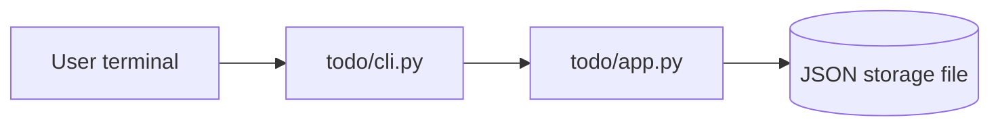

# Architecture

Design for the approved `artifacts/requirements.md` (US-1, FR-1 to FR-11, NFR-1 to NFR-4, AC-1 to AC-13). The requirements are not changed or reinterpreted here. Where they leave a question open, this document records a design decision and flags it for the human reviewer.

## Context

The product is a small Python command-line application that manages a single list of tasks. A user adds tasks, views them in creation order, completes them, reopens them, and deletes them. Every task has an id, a free-text title, and a status of `open` or `done`.

Constraints:

- Python 3.11 or later, standard library only (NFR-1).
- The command line is the only interface. There is no server, no network access and no graphical interface (AC-12).
- Each command is a separate process run. State must therefore survive between runs, otherwise "add, then view" cannot work. The requirements leave persistence as an open question; Decision D-1 settles it for the design.

Existing code in `todo/` is a starting sample and does not yet meet the requirements. The implementation phase must close these gaps:

| Gap in current code | Requirement affected | Resolved by |
| --- | --- | --- |
| No `reopen` command or operation | FR-8, FR-9 | `TodoList.reopen`, `reopen` command |
| `complete` on a done task is silent and reports success | FR-7 | `(item, changed)` result and no-op message |
| New id is `max(existing ids) + 1`, so an id can be reused after the newest task is deleted | FR-2, NFR-4, AC-2 | persisted `next_id` counter |
| Titles are whitespace-normalised and limited to 200 characters | NFR-2, AC-13 | store the title exactly as entered, no length limit |
| Status is a boolean `done` and is not displayed as `open` or `done` | FR-2, FR-3, FR-4 | string status field shown in every output |
| Invalid id such as `abc` is rejected by `argparse` with a usage error and exit code 2 | FR-11, AC-11 | ids are read as text and validated by the application |
| Command is named `remove` | FR-10 | command is named `delete` (Decision D-4) |

## Components

All runtime code lives in the `todo/` package. Tests live in `tests/test_todo.py`.



### `todo/app.py` - logic and storage

Owns all rules and the only access to the storage file. It does no printing and reads no command-line arguments.

- `TodoError`: the single exception type for every user-correctable problem (invalid id, unknown id, empty title, unreadable or unwritable storage). Its message is written for the end user.
- `Item`: dataclass with `id: int`, `title: str`, `status: str`. `status` is always `open` or `done`.
- `TodoList`: loads the file on construction, holds the items in creation order, and saves after every change.
- `parse_id(text: str) -> int`: converts command-line text into a task id or raises `TodoError`.
- `format_item(item: Item) -> str`: one display line for a task, with control characters in the title made visible (see Security Considerations).

### `todo/cli.py` - command line

Owns argument parsing, message wording, output streams and exit codes. It contains no task rules. It calls `TodoList`, prints the result, and turns `TodoError` into an error message on standard error and exit code 1.

- `build_parser()`: defines the commands `add`, `list`, `done`, `reopen`, `delete`, and the option `--file`.
- `main(argv) -> int`: runs one command and returns the exit code.

### Storage file

One JSON file, default `todo.json` in the current directory, overridable with `--file`. It is read at the start of each run and replaced atomically after each change.

## Data and Interfaces

### Storage format

```json
{
  "version": 1,
  "next_id": 4,
  "items": [
    {"id": 1, "title": "Buy milk", "status": "open"},
    {"id": 3, "title": "Pay rent", "status": "done"}
  ]
}
```

- `items` is in creation order. Items are appended, never reordered, so file order is creation order (FR-4).
- `next_id` is the id the next new task receives. It only ever increases, so an id is never reused, even after the newest task is deleted (FR-2, NFR-4, AC-2).
- On load, `next_id` must be greater than every id in `items`. Ids must be unique and positive whole numbers, and `status` must be `open` or `done`. Any violation raises `TodoError` and no command changes the file.
- A missing file means an empty list with `next_id` 1. The file is created on the first change.
- The file is written as UTF-8. Titles round-trip exactly, including spaces, punctuation and non-ASCII characters (NFR-2, AC-13).
- Files written by the earlier sample code (a boolean `done` field and no `next_id`) are not read. They fail the load check with a clear message. The sample has no released data to migrate, so a migration path is not designed.

### Function signatures (`todo/app.py`)

```python
class TodoError(Exception): ...

@dataclass
class Item:
    id: int
    title: str
    status: str  # "open" or "done"

def parse_id(text: str) -> int: ...

def format_item(item: Item) -> str: ...

class TodoList:
    def __init__(self, path: Path) -> None: ...
    def add(self, title: str) -> Item: ...
    def list(self) -> list[Item]: ...
    def complete(self, item_id: int) -> tuple[Item, bool]: ...
    def reopen(self, item_id: int) -> tuple[Item, bool]: ...
    def delete(self, item_id: int) -> Item: ...
```

Rules:

- `add(title)`: raises `TodoError` if the title is empty or only whitespace (Decision D-2). Otherwise the title is stored exactly as given, with no trimming, normalising or length limit. The new task gets `next_id`, status `open`, and is appended. `next_id` increases by one. The change is saved.
- `list()`: returns a copy of the items in creation order. It never writes.
- `complete(item_id)`: if the task is `open`, set `done`, save, and return `(item, True)`. If it is already `done`, change nothing, do not write, and return `(item, False)` (FR-6, FR-7).
- `reopen(item_id)`: the mirror of `complete` (FR-8, FR-9).
- `delete(item_id)`: remove the task, save, and return it. `next_id` is not changed (FR-10, NFR-4).
- `complete`, `reopen` and `delete` raise `TodoError("no task with id N")` when no task has that id. The list is unchanged (FR-11).
- `parse_id(text)`: accepts only ASCII digits that make a whole number of at least 1. Anything else (for example `abc`, `1.5`, `-3`, `0`, empty text) raises `TodoError` with a message that names the bad value and says an id is a whole number such as 1 (FR-11, AC-11). An invalid id is therefore reported before the list is consulted, and a valid but unmatched id is reported as unknown (Decision D-3).
- Saving writes a temporary file in the same directory, flushes and syncs it, then replaces the target with `os.replace`. A failed write leaves the previous file intact and raises `TodoError`.

### Command line (`todo/cli.py`)

Run as `python3 -m todo.cli [--file PATH] <command> ...`.

| Command | Arguments | Success output (standard output) | No-op output | Satisfies |
| --- | --- | --- | --- | --- |
| `add` | one or more words, joined with single spaces, or one quoted title | `added task 3: open - Buy milk` | none | FR-1, FR-2, FR-3 |
| `list` | none | one line per task: `3  open  Buy milk` | `no tasks yet` when the list is empty | FR-4, FR-5 |
| `done` | `ID` | `task 3 is now done: Buy milk` | `task 3 is already done: Buy milk` | FR-6, FR-7 |
| `reopen` | `ID` | `task 3 is now open: Buy milk` | `task 3 is already open: Buy milk` | FR-8, FR-9 |
| `delete` | `ID` | `deleted task 3: Buy milk` | none | FR-10 |

Exact wording is fixed by the implementation and tests, but every output for a task includes its id, status and title where the requirements call for them.

For `add`, the words after the command are joined with a single space. A user who needs the exact spacing of a title (AC-13) quotes it as one argument, and a single argument is stored unchanged.

Exit codes:

| Code | Meaning |
| --- | --- |
| 0 | The command succeeded, including a no-op that printed a no-op message |
| 1 | `TodoError`: invalid id, unknown id, empty title, or unreadable or unwritable storage. The message goes to standard error as `error: <message>` |
| 2 | Command-line usage error reported by `argparse` (missing command or argument, unknown command). This is the standard `argparse` behaviour and is not an id problem |

Error handling:

- Ids are declared as text arguments in `argparse` so that every id problem goes through `parse_id` and produces the clear message with exit code 1.
- No stack trace is shown for `TodoError`. Unexpected exceptions are not caught, so a real defect is visible rather than hidden.
- A failed command never leaves a partial change: validation happens before any mutation, and the file is replaced atomically.

## Security Considerations

The application runs locally with the privileges of the user who starts it and has no network exposure, so the relevant risks are limited to input handling and file handling.

- **No code execution from input.** Titles and ids are never evaluated, passed to a shell, or used to build commands or file paths. Ids are validated to ASCII digits before conversion.
- **Safe parsing of stored data.** The storage file is parsed with `json` only, never with `pickle` or `eval`. Every field is type-checked and range-checked on load, so a damaged or hand-edited file produces a `TodoError` and not a crash or silent corruption.
- **Terminal output safety.** A free-text title could contain control characters or terminal escape sequences. `format_item` shows these characters as visible escapes (for example `\x1b`) when printing. The stored title is not altered, and ordinary spaces, punctuation and non-ASCII text print as entered (AC-13).
- **File handling.** The storage path comes from the user's own `--file` option or the default in the current directory. Atomic replacement avoids half-written files. The temporary file is created by `tempfile.mkstemp`, which uses owner-only permissions, and is removed if the write fails.
- **No secrets.** The application handles no credentials, tokens or personal data beyond the task text the user types. Nothing is logged to files.
- **Concurrent runs.** Two simultaneous runs against the same file are not coordinated. The last atomic replace wins. This is acceptable for a single-user tool and is not a requirement.

## Decisions and Trade-offs

- **D-1 Persistence in a JSON file (answers the open question on persistence).** An in-memory list cannot work with a command-per-run interface, so tasks are stored in a JSON file. JSON is in the standard library, readable, and easy to inspect and test. A database was rejected as more than a small tool needs. Human confirmation requested.
- **D-2 Empty or whitespace-only titles are rejected (answers the open question on empty titles).** A task with no visible title cannot be recognised in the list. All other text is accepted as entered (NFR-2). Human confirmation requested.
- **D-3 Invalid and unknown ids use separate messages (answers the open question on id errors).** Both are clear errors with exit code 1 and neither changes any task. Separate messages tell the user whether the text was malformed or the task does not exist. Human confirmation requested.
- **D-4 Command names `add`, `list`, `done`, `reopen`, `delete` (answers the open question on names and wording).** These follow the verbs in the user story. The sample's `remove` becomes `delete` to match FR-10. Message wording is an implementation detail covered by the table above.
- **D-5 Never reuse ids with a persisted `next_id` counter.** Computing `max(id) + 1` is simpler but reuses an id after the newest task is deleted, which violates NFR-4 and AC-2. The cost is one extra field in the file.
- **D-6 A no-op is a success.** Completing a done task or reopening an open task prints a message and exits with 0, because the user's goal state already holds. Using a failing exit code was rejected as it would make scripts treat a harmless repeat as an error.
- **D-7 Logic and presentation are split.** `app.py` returns data and raises `TodoError`, and `cli.py` decides wording and exit codes. This lets every rule be tested without running a process.
- **D-8 Title kept exactly as entered.** The sample's whitespace normalisation and 200-character limit are removed because NFR-2 and AC-13 require exact storage and display. The trade-off is that very long titles are possible, limited only by the command line.
- **D-9 Standard library only.** `argparse`, `json`, `pathlib`, `tempfile` and `os` cover every need, which keeps the application small (NFR-1).

## Traceability

| Requirement | Satisfied by | Notes |
| --- | --- | --- |
| FR-1 | `todo/cli.py` `add` command, `TodoList.add` in `todo/app.py` | free-text title, empty title rejected (D-2) |
| FR-2 | `TodoList.add`, `next_id` in storage file | unique id, status `open` |
| FR-3 | `todo/cli.py` `add` output, `format_item` in `todo/app.py` | prints id, status and title |
| FR-4 | `TodoList.list`, `todo/cli.py` `list` command | file order is creation order |
| FR-5 | `todo/cli.py` `list` command | prints `no tasks yet` |
| FR-6 | `TodoList.complete`, `todo/cli.py` `done` command | open to done |
| FR-7 | `TodoList.complete` returning `(item, False)`, `todo/cli.py` no-op message | no write on no-op |
| FR-8 | `TodoList.reopen`, `todo/cli.py` `reopen` command | done to open |
| FR-9 | `TodoList.reopen` returning `(item, False)`, `todo/cli.py` no-op message | no write on no-op |
| FR-10 | `TodoList.delete`, `todo/cli.py` `delete` command | task removed from file |
| FR-11 | `parse_id` and `TodoList._find` in `todo/app.py`, error handling in `todo/cli.py` | exit code 1, no change to the file |
| NFR-1 | `todo/cli.py` and `todo/app.py` | Python 3.11+, standard library only, command line only |
| NFR-2 | `TodoList.add`, JSON storage as UTF-8 | no trimming and no length limit |
| NFR-3 | `TodoError` messages in `todo/app.py`, message table in `todo/cli.py` | user-oriented wording, tested |
| NFR-4 | `next_id` in the storage file and `TodoList.add` and `TodoList.delete` | counter only increases |

Acceptance criteria map through their requirements: AC-1 to FR-1, FR-2, FR-3; AC-2 to FR-2, NFR-4; AC-3 to FR-4; AC-4 to FR-5; AC-5 to FR-6; AC-6 to FR-7; AC-7 to FR-8; AC-8 to FR-9; AC-9 to FR-10; AC-10 and AC-11 to FR-11; AC-12 to NFR-1; AC-13 to NFR-2.
