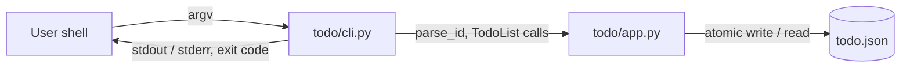

# Architecture

## Context

The approved requirements (`artifacts/requirements.md`) describe one story, US-1: a user manages a simple list of tasks from the command line. The list supports create, view, complete, reopen and delete, with clear messages for no-ops, empty lists and invalid or unknown ids (FR-1 to FR-11). The application is a small Python command-line program (NFR-1) that accepts free-text titles (NFR-2), prints clear messages (NFR-3) and never reuses an id (NFR-4).

The requirements leave four questions open: persistence between runs, empty titles, whether invalid and unknown ids share a message, and the exact command names and wording. This design resolves them with explicit decisions (see Decisions and Trade-offs). The human approver may overrule any of them at approval time.

Scope is deliberately small: two modules in `todo/`, a JSON file for storage, the Python standard library only. There is no network access, no server, no database and no configuration system.



## Components

| Component | File | Responsibility |
|-----------|------|----------------|
| Package marker | `todo/__init__.py` | Makes `todo` an importable package so `python3 -m todo.cli` works. |
| Domain logic | `todo/app.py` | Task model, id validation, status transitions, display escaping, loading and saving the JSON file. Contains no printing and no argument parsing. |
| Command line | `todo/cli.py` | Builds the argument parser, calls `app.py`, prints results to stdout and errors to stderr, and maps outcomes to exit codes. Contains no business rules. |
| Tests | `tests/test_todo.py` | Covers every acceptance criterion through `app.py` functions and through `cli.main`. |

Dependency direction: `cli.py` depends on `app.py`; `app.py` depends only on the standard library (`json`, `os`, `re`, `tempfile`, `pathlib`, `dataclasses`).

## Data and Interfaces

### Storage format

One UTF-8 JSON file, default `todo.json` in the current directory, overridable with the global option `--file PATH`.

```json
{
  "version": 1,
  "next_id": 4,
  "items": [
    {"id": 1, "title": "Buy milk", "status": "open"},
    {"id": 3, "title": "Call Ana", "status": "done"}
  ]
}
```

- `items` is in creation order. New tasks are appended; no operation reorders the list (FR-4).
- `next_id` is a persisted counter that only increases. A new task takes `next_id`, then the counter is incremented. Deleting a task does not lower it, so an id is never reused, including after the newest task is deleted (FR-2, NFR-4, AC-2).
- `status` is exactly `open` or `done` (FR-2, FR-6, FR-8).
- A missing file means an empty list. The file is created on the first successful change.
- On load, the file is validated: top level is an object, `version` equals 1, `next_id` is a whole number of at least 1 and greater than every item id, each item has a unique whole-number id of at least 1, a string title and a valid status. Any violation raises a user-readable error and the program changes nothing.

### Writes

Each change is built in memory and saved with a temporary file in the same directory, then `os.replace` onto the target. The in-memory state is updated only after the save succeeds, so a failed write leaves both the file and the session state unchanged (FR-11: no task changes on error).

### Function signatures (`todo/app.py`)

```python
class TodoError(Exception): ...              # message is written for the end user

@dataclass
class Item:
    id: int
    title: str
    status: str = "open"                     # "open" | "done"

def escape_text(text: str) -> str: ...       # non-printable characters shown as visible escapes
def parse_id(text: str) -> int: ...          # whole number >= 1, else TodoError
def format_item(item: Item) -> str: ...      # "<id>  <status>  <title>"

class TodoList:
    def __init__(self, path: Path) -> None: ...        # loads and validates the file if present
    def add(self, title: str) -> Item: ...
    def list(self) -> list[Item]: ...                  # creation order, copies
    def complete(self, item_id: int) -> tuple[Item, bool]: ...   # bool is "changed"
    def reopen(self, item_id: int) -> tuple[Item, bool]: ...
    def delete(self, item_id: int) -> Item: ...
```

`complete` and `reopen` return `(item, changed)`. `changed` is false for a no-op, which lets the CLI print the no-op message (FR-7, FR-9) without a second lookup.

### CLI commands (`todo/cli.py`)

Invocation: `python3 -m todo.cli [--file PATH] <command> ...`

| Command | Behavior | Success output (stdout) |
|---------|----------|-------------------------|
| `add TITLE...` | Joins the words with single spaces, adds an open task (FR-1, FR-2) | `added task <id>: open - <title>` (FR-3) |
| `list` | Prints every task in creation order (FR-4) | One line per task: `<id>  <status>  <title>`; if none: `no tasks yet` (FR-5) |
| `done ID` | Open becomes done (FR-6) | `task <id> is now done: <title>`; if already done: `task <id> is already done: <title>` (FR-7) |
| `reopen ID` | Done becomes open (FR-8) | `task <id> is now open: <title>`; if already open: `task <id> is already open: <title>` (FR-9) |
| `delete ID` | Removes the task (FR-10) | `deleted task <id>: <title>` |

A title or id that starts with a dash must follow `--` (for example `add -- -urgent`); the help text says so.

### Exit codes and errors

| Code | Meaning |
|------|---------|
| 0 | Success, including no-ops and the empty-list message |
| 1 | A `TodoError`: invalid id, unknown id, empty title, unreadable or invalid storage file, unwritable storage |
| 2 | Command-line usage error reported by `argparse` (missing command, missing argument, unknown option) |

Errors are printed to stderr as `error: <message>` and never include a stack trace.

| Situation | Message pattern | Requirement |
|-----------|-----------------|-------------|
| Id is not a whole number of at least 1 (for example `abc`, `-1`, `1.5`, `0`) | `invalid id '<id>': an id is a whole number such as 1` | FR-11, AC-11 |
| Id is valid but matches no task | `no task with id <n>` | FR-11, AC-10 |
| Empty or whitespace-only title | `title must not be empty` | Decision D-3 |
| Storage file cannot be read or fails validation | `cannot read <path>: <reason>` | Robustness |
| Storage file cannot be written | `cannot write <path>: <reason>` | Robustness |

Validation happens before any state change, so an error never changes a task (FR-11).

### Display rules

Titles are stored exactly as entered. When printed, printable characters, including spaces, punctuation and non-ASCII letters, are shown unchanged (AC-13). Non-printable characters (control characters, escape sequences, newlines) are shown as visible escapes such as `\x1b`, so a title cannot manipulate the terminal. Echoed invalid ids are escaped and truncated to 40 characters.

## Security Considerations

- **No code or shell execution.** Input is only parsed as text. Nothing uses `eval`, `exec`, `pickle`, `shell=True` or string-built commands.
- **Terminal injection.** Titles and echoed ids are untrusted. Non-printable characters are escaped on every output path, including error messages and the storage path shown in errors.
- **Input validation.** Ids are matched against ASCII digits only, limited to 18 digits (so they fit in a signed 64-bit range), and must be at least 1. Unicode digits and signs are rejected.
- **Storage integrity.** The file is parsed with `json` only. Structure, types, uniqueness and `next_id` are validated before use, so a corrupted or hand-edited file produces an error instead of undefined behavior.
- **Atomic, private writes.** `tempfile.mkstemp` creates an owner-only file, which is fsynced and moved into place with `os.replace`. A crash cannot leave a half-written list. A symbolic link at the storage path is replaced, not followed.
- **Storage location.** The path is chosen by the user through `--file`. The program writes only to that path and its parent directory and does not interpret it further. It is a single-user local tool; concurrent writers are not supported (see D-5).
- **Dependencies and secrets.** Standard library only at runtime, so there is no third-party supply chain. The application reads no environment secrets and makes no network calls.
- **Error handling.** Expected failures are `TodoError` and are printed as one line. Unexpected exceptions are not hidden, so defects are not masked.

## Decisions and Trade-offs

| Id | Decision | Alternatives | Rationale |
|----|----------|--------------|-----------|
| D-1 | Persist tasks in a JSON file between runs. This answers the persistence question. | In-memory only | A command-line program with separate invocations has no list to view or modify without persistence. JSON is human-readable and needs no dependency. |
| D-2 | Use a persisted, increasing `next_id` counter. | `max(id) + 1` | `max(id) + 1` reuses the id of a deleted newest task and breaks NFR-4 and AC-2. |
| D-3 | Reject empty or whitespace-only titles with exit code 1. This answers the empty-title question. | Allow empty titles | A blank row is not useful. This is a small restriction on NFR-2 and is flagged for the approver, who may choose to allow empty titles instead. |
| D-4 | Use one message style for invalid and unknown ids, with different wording that states the cause. | One shared message | Requirements ask only for a clear error. Distinct wording tells the user whether the text was wrong or the task is missing, at no extra cost. |
| D-5 | No file locking; single-user tool. | Lock file or database | Locking adds complexity beyond the requirements. Atomic replacement protects file integrity, though two simultaneous writers could lose one update. |
| D-6 | Command names are `add`, `list`, `done`, `reopen`, `delete`, with a `--file` option. This answers the naming question. | Different verbs | Short, one word each, and aligned with the requirement wording. |
| D-7 | Keep logic in `app.py` without printing; keep `cli.py` free of rules. | Single module | Logic can be tested without capturing output, and the split matches the repository convention. |
| D-8 | Standard library only, `argparse` for the command line. | Third-party CLI library | Satisfies NFR-1 with no installation step. |

## Traceability

| Requirement | Satisfied by | How |
|-------------|--------------|-----|
| FR-1 | `cli.py` `add`; `app.py` `TodoList.add` | Words joined into a free-text title and appended |
| FR-2 | `app.py` `TodoList.add`, `next_id` | New id from the counter, status `open` |
| FR-3 | `cli.py` `add` output | Prints id, status and title |
| FR-4 | `app.py` `TodoList.list`, `format_item`; `cli.py` `list` | Items kept and returned in creation order, with id, status and title |
| FR-5 | `cli.py` `list` | Prints `no tasks yet` for an empty list |
| FR-6 | `app.py` `TodoList.complete`; `cli.py` `done` | Open task becomes done and is saved |
| FR-7 | `app.py` `_set_status` returning `changed=False`; `cli.py` | Prints `is already done`, no save |
| FR-8 | `app.py` `TodoList.reopen`; `cli.py` `reopen` | Done task becomes open and is saved |
| FR-9 | `app.py` `_set_status` returning `changed=False`; `cli.py` | Prints `is already open`, no save |
| FR-10 | `app.py` `TodoList.delete`; `cli.py` `delete` | Task removed and the list saved |
| FR-11 | `app.py` `parse_id`, `_find`, `TodoError`; `cli.py` error handling | Clear stderr message, exit code 1, validation before any change |
| NFR-1 | `todo/cli.py`, `todo/app.py` | Small Python command-line program, standard library only |
| NFR-2 | `app.py` storage and `escape_text` | Title stored exactly as entered; printable text displayed unchanged; only empty titles are rejected (D-3) |
| NFR-3 | `cli.py` message set and error table | Every no-op, empty-list and error case has a dedicated plain-language message |
| NFR-4 | `app.py` persisted `next_id` | Counter never decreases, so ids are not reused after deletion |
